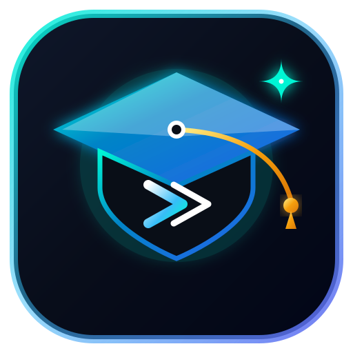

<p align="center">
  
</p>

# MockShift (SimulCast AI) — Bring Your Own Paper (BYOP) CBT Exam Simulator

[](https://mockshift.onrender.com)
[](https://render.com/deploy?repo=https://github.com/sayan2b1/MockShift)
[](https://opensource.org/licenses/MIT)
[](https://fastapi.tiangolo.com)
[](https://ai.google.dev/)

**MockShift** is a state-of-the-art "Bring Your Own Paper" Computer-Based Test (CBT) simulator and AI-powered post-test analytics engine designed for Indian competitive exams (**CAT, GATE, JEE, NEET, UPSC, SSC, Banking, CUET, and Custom**).

🔗 **Live Website:** [https://mockshift.onrender.com](https://mockshift.onrender.com)

Powered by the modern `google-genai` Python SDK, MockShift pairs **`gemini-3.5-flash-lite`** for high-speed, token-efficient PDF extraction with resilient multi-model fallback (**`gemini-3.6-flash`**, **`gemini-3.5-flash`**, **`gemini-3.8-flash`**) for lazy answer solving, surgical mistake autopsies, and adaptive weakness drills.

---

## 🌐 1-Click Public Cloud Deployment (Access from Anywhere)

You can host MockShift online for free so anyone can use it without running localhost:

### Option A: 1-Click Deploy on Render (Recommended)
1. Click the **[Deploy to Render](https://render.com/deploy?repo=https://github.com/sayan2b1/MockShift)** button above (or connect `sayan2b1/MockShift` in [Render Dashboard](https://dashboard.render.com)).
2. Set your environment variable:
   - `GEMINI_API_KEY`: Your Gemini API Key from [Google AI Studio](https://aistudio.google.com/) *(optional if students use their own keys via the in-app BYOK modal)*.
3. Render will deploy the application and give you a public URL (e.g. `https://mockshift.onrender.com`) that anyone can open from any device!

### Option B: Deploy on Railway
1. Go to [Railway.app](https://railway.app/) and select **New Project** → **Deploy from GitHub repo** → **`sayan2b1/MockShift`**.
2. Add `GEMINI_API_KEY` under Variables.
3. Click **Generate Domain** to get an instant public URL (e.g. `https://mockshift-production.up.railway.app`).

---

## ⚡ Architectural Highlights

1. **100% Stateless Backend (Zero Database):**
   - Zero serverside databases (no Postgres, MongoDB, or Firebase).
   - In-progress answers, 5-state palette status, per-question timers, countdowns, and focus break logs are managed directly in the browser via `localStorage` with crash recovery.
   - Cross-device sync is handled client-side via Google Drive's hidden `appDataFolder` (`mockshift_history.json`).
2. **Token-Optimized Lazy-Solving Pipeline:**
   - **Stage 1 (Upload):** `gemini-3.5-flash-lite` extracts *only* question stems, options, types (`MCQ`, `MSQ`, or `NAT`), and printed answer keys. Unkeyed questions default to `correct_answer: null`.
   - **Stage 2 (Submit):** Only attempted questions with missing keys are sent in batches of 10–15 to `gemini-3.6-flash` for final answer keys (`{"q_id": "answer"}`)—strictly zero explanations to minimize tokens and latency.
   - **Stage 3 (Review):** Comprehensive step-by-step solutions are generated on-demand *only* when the student clicks "AI Mistake Autopsy" on a wrong or skipped question.
   - **Adaptive Weakness Drill:** Generates an adaptive 5-question, 10-minute targeted mini-quiz targeting the exact concepts missed.
3. **Local PyMuPDF Text Check & Diagram Grounding:**
   - Evaluates whether the uploaded PDF has clean selectable text before sending to Gemini. Text PDFs avoid multimodal token consumption; diagram-heavy or scanned PDFs seamlessly fall back to Gemini's native PDF ingestion.
   - Isolates genuine diagrams, circuit schematics, and plots with tight bounding box cropping at 180 DPI (rejecting full-page document scans).
4. **Authentic Exam-Hall Interface:**
   - **5-State Question Palette:** Not Visited, Not Answered, Answered, Marked for Review, Answered & Marked for Review (Evaluated).
   - **Responsive Drawer:** Below 900px, the palette smoothly collapses into a slide-over drawer triggered by a floating `Palette (Answered/Total)` action button.
   - **Power-User Keyboard Shortcuts:** `1-4` / `A-D` for MCQ options, `ArrowRight`/`Enter` for Save & Next, `ArrowLeft` for Previous, `M` for Mark for Review, and `Escape` to close modals.
   - **Virtual Calculator (`calculator.js`):** Mouse-only TCS iON Scientific Calculator (postfix unary ops, Deg/Rad) for GATE and Basic Calculator for CAT.
   - **Virtual Numpad:** Mouse-only on-screen keypad for NAT / TITA numerical questions.
   - **Exam-Hall Lockdown Mode:** Fullscreen enforcement, disabled context menu and copy-paste shortcuts, with active focus-break tracking (window blur / tab switch).
5. **Post-Test Intelligence & Behavioral Quadrants (Chart.js):**
   - Executive scorecard tracking Net Score (+Marks Gained, -Marks Lost), Accuracy %, Attempt Rate, Avg Pace, and Discipline.
   - Section-Wise Performance Breakdown Table.
   - Time Spent vs. Accuracy scatter plot classifying questions into:
     - 🟢 **Mastery Zone (Fast & Correct)**
     - 🟠 **Careless Slips (Fast & Incorrect)**
     - 🔵 **Deep Grinds (Slow & Correct)**
     - 🔴 **Time Traps (Slow & Incorrect)**
   - Click any scatter point to jump directly to the question with a smooth scroll and pulse highlight!
6. **Paper Portability & Print Suite:**
   - **Export Paper (.json):** Download clean KaTeX-ready JSON exam papers (0 user answers, 0 API keys).
   - **Import Shared Paper (.json):** Instantly load a classmate's paper directly into the CBT engine with 0 Gemini API calls.
   - **Printable PDF Reports:** Dedicated `@media print` rules format the scorecard and review table onto clean high-contrast white pages with `window.print()`.

---

## 📁 Project Structure

```
MockShift/
├── backend/
│   ├── main.py              # FastAPI app, static file serving, cloud health checks & CORS
│   ├── schemas.py           # Pydantic models for strict JSON Structured Outputs
│   ├── pdf_parser.py        # PyMuPDF text inspector + gemini-3.5-flash-lite parser
│   ├── ai_solver.py         # gemini-3.6-flash batch solver, autopsy & weakness drill
│   ├── sample_paper.json    # Built-in demo paper (LaTeX math, CAT/GATE hybrid)
│   ├── requirements.txt     # Python dependencies
│   └── .env.example         # GEMINI_API_KEY & CORS_ORIGINS configuration
├── frontend/
│   ├── index.html           # Upgraded single-page CBT simulator (Zero build steps)
│   ├── styles.css           # Dark mode + deep teal aesthetic, responsive drawer, print rules
│   ├── app.js               # Core CBT state machine, keyboard shortcuts, paper export/import
│   ├── calculator.js        # Mouse-only TCS iON GATE Scientific & CAT Basic Calc
│   ├── analytics.js         # Behavioral Quadrant scatter plot, autopsies & drills
│   ├── auth_history.js      # Student profile & cross-device history sync
│   ├── drive_upload.js      # Google Drive REST API & appDataFolder sync helpers
│   └── config.js            # OAuth Client ID & Drive scope configuration
├── render.yaml              # Cloud deployment Blueprint (Render / Railway / Cloud Run)
└── README.md
```

---

## 🚀 Quickstart Guide

### 1. Set your Gemini API Key
In `MockShift/backend/`, copy `.env.example` to `.env` and insert your Gemini API Key:
```bash
GEMINI_API_KEY=your_actual_gemini_api_key_here
```

### 2. Run the FastAPI Dev Server
Using the project virtual environment:
```powershell
# From project root:
.\.venv\Scripts\python.exe -m uvicorn main:app --host 127.0.0.1 --port 8000 --app-dir MockShift/backend --reload
```

Or with global Python:
```bash
cd MockShift/backend
pip install -r requirements.txt
uvicorn main:app --reload --port 8000
```

### 3. Open in Browser
Visit **`http://localhost:8000`** in your browser!

- Click **"12Q Benchmark Demo"** to instantly test with 0 API calls.
- Click **"Import Shared Paper (.json)"** to load any exported exam paper with 0 API calls.
- Upload any PDF question paper to parse with Gemini.
- Review questions in the **Pre-Exam Quick Editor** with live KaTeX math preview.
- Click **"Start Exam"** to enter the authentic CBT testing interface with keyboard shortcuts.
- Open the **Virtual Calculator** (TCS iON GATE Scientific or CAT Basic) or use the **Virtual Numpad**.
- Submit the test to view the **Behavioral Quadrants**, **Section Breakdown**, on-demand **AI Mistake Autopsies**, and **Download PDF Report**!
